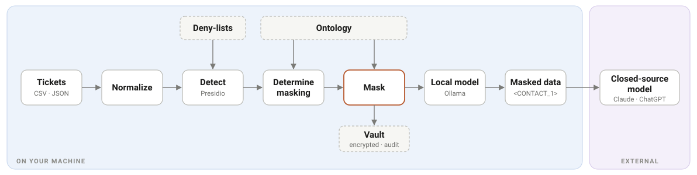

# ticketmask

Mask the personal data in support tickets on your own machine, so the text can
go to a local model and then a closed-source model (Claude, ChatGPT) without
customer data ever leaving.



## What's included

| Part | Where | What it does |
|---|---|---|
| Presidio masking app | `src/ticketmask/`, `app/` | Finds and masks PII in ticket exports with [Microsoft Presidio](https://github.com/microsoft/presidio), plus ticket-specific recognizers and deny-lists. Keeps an encrypted vault per ticket for audits. Has a CLI and a Streamlit UI. |
| Generic support ontology | `support-ontology/` | 17 classes (Account, Contact, Ticket, Product, SeverityLevel…) that every masking entity type binds to. The products, CRMs and severity wording are templates to replace with your own. Browse it in `support-ontology/Navigator/index.html`. |
| Local model prompt | `prompts/local_model_masking.md` | System prompt for a second pass by a local model. It masks what the first pass missed, then returns an HTML report with the changes, the fully masked tickets and draft knowledge base articles. |
| Sample tickets | `samples/` | 20 synthetic tickets with ground-truth PII labels, matching deny-lists, and CSV and JSON exports for testing. |

Masking runs entirely on your machine. Only the masked output is meant to go to
a model.

## Quick start

```bash
python -m venv .venv
.venv/bin/pip install -e .                 # Windows: .\.venv\Scripts\pip
.venv/bin/pip install https://github.com/explosion/spacy-models/releases/download/en_core_web_lg-3.8.0/en_core_web_lg-3.8.0-py3-none-any.whl
cp .env.example .env                       # then set TICKETMASK_VAULT_KEY
```

```bash
ticketmask mask tickets.csv --id-field ticket_id --text-fields subject,description --out data/out
```

`data/out/masked.jsonl` is the masked data, and the only output meant to reach
a model, local or closed-source. `vault/` holds the way back to the original
values and stays on your machine.

There is also a UI that maps your export's columns for you. Install it with
`pip install -e .[app]` and start it with `streamlit run app/streamlit_app.py`.

## Try it with the sample data

Everything in `samples/` is fictional. `tickets.annotated.jsonl` is the source
of truth, with every PII span labelled `[[TYPE|value]]`. `tickets.csv` and
`tickets.json` hold the same tickets the way a helpdesk would export them
(regenerate them with `python scripts/build_samples.py`).

To measure leaks against the labels:

```bash
python scripts/measure.py --corpus samples/tickets.annotated.jsonl --deny-lists samples/deny-lists -v
```

To mask the export the way you would a real one:

```bash
ticketmask mask samples/tickets.csv --id-field ticket_id --text-fields subject,description,comments --accounts samples/deny-lists/accounts.txt --partners samples/deny-lists/partners.txt --contacts samples/deny-lists/contacts.txt --agents samples/deny-lists/agents.txt --sales-reps samples/deny-lists/sales-reps.txt --csms samples/deny-lists/csms.txt --sites samples/deny-lists/sites.txt --products samples/deny-lists/products.txt --out data/out
```

The contacts and sites lists are incomplete on purpose, as a real CRM export
would be. Some tickets also contain things no recognizer catches yet: a street
address, an unlabelled API key, and a Windows username in a file path. Those
leaks show what to tune next.

## Second pass with a local model

Presidio misses some things, such as a first name on its own, a username in a
file path or an unlabelled API key. `prompts/local_model_masking.md` asks a
local model to find and mask those, list each change, and write knowledge base
articles from the result. It returns one self-contained HTML file. A JSON block
inside it repeats the changes and masked text so code can check them.

Use the file as the system prompt and send one ticket from
`data/out/masked.jsonl` per request as the user message. With Ollama, call
`/api/chat` with `"think": false` and `num_ctx` of at least 16384 (the default
of 4096 silently cuts long tickets).

Treat the output as a draft that code must check before anyone uses it. In tests
on the sample tickets with `gemma4:e4b-it-qat`, a 4B model, the model caught a
lone first name, a name in a data row and a username in a file path. It missed
a street address and sometimes renumbered placeholders the
first pass had already set. Before using a report, confirm that every
placeholder from the input survived unchanged and that no original value
appears in it. A larger model will do better.

## Browse the ontology

Open `support-ontology/Navigator/index.html` in a browser to get an interactive
graph of the 17 classes and 26 relationships. Clicking a class shows its
definition, aliases, attributes and constraints. If your browser blocks local
scripts, serve the folder instead:

```bash
python -m http.server 8765 --directory support-ontology/Navigator
```

After editing the ontology, rebuild the graph with
`python support-ontology/scripts/build_graph.py`.

## Making the ontology yours

The ontology in `support-ontology/` is generic. To tailor it:

1. Edit the markdown in `support-ontology/Ontology/`. Start with
   `Entities/Product.md` (your products), `Entities/CRM.md` (your ticketing
   systems) and `Entities/SeverityLevel.md` (your severity policy).
2. Run `python support-ontology/scripts/validate_ontology.py`.
3. Regenerate the navigator and exports with `python support-ontology/scripts/build_graph.py`, `python support-ontology/scripts/export_glossary_csv.py`
   and `python support-ontology/scripts/export_rdf.py`.
4. Run `ticketmask compliance` to confirm the masker is still in sync.

To keep a private ontology outside the repo, point `TICKETMASK_ONTOLOGY_DIR` at
it. The folder needs the same `Ontology/` and `Export/` layout.

## Setup on Windows

Run these from a normal PowerShell window in this folder. You need Python 3.11
or later; the project is built and tested on 3.14.

```powershell
py -3.14 -m venv .venv
```

```powershell
.\.venv\Scripts\python.exe -m pip install -e .
```

```powershell
.\.venv\Scripts\python.exe -m pip install https://github.com/explosion/spacy-models/releases/download/en_core_web_lg-3.8.0/en_core_web_lg-3.8.0-py3-none-any.whl
```

The spaCy model is a 400 MB download and is not on PyPI, so it gets its own
install line instead of being a dependency.

Then create a vault key:

```powershell
.\.venv\Scripts\python.exe -c "from cryptography.fernet import Fernet; print('TICKETMASK_VAULT_KEY=' + Fernet.generate_key().decode())" | Out-File -FilePath .env -Encoding utf8
```

`.env` is gitignored. In production the key should come from a KMS or Key
Vault, not a file. The CLI reads the environment first and only falls back to
`.env`.

## Running it

Installing with `-e .` puts a `ticketmask` command inside the venv, so you do
not need to set `PYTHONPATH`.

Activate the venv once per shell:

```powershell
.\.venv\Scripts\Activate.ps1
```

If PowerShell blocks the activation script, either run the following once for
your user, or skip activation and call `.\.venv\Scripts\ticketmask.exe`
directly:

```powershell
Set-ExecutionPolicy -Scope CurrentUser -ExecutionPolicy RemoteSigned
```

To mask an export:

```powershell
ticketmask mask data\in\tickets.csv --id-field ticket_id --text-fields subject,description,comments --accounts data\in\accounts.txt --agents data\in\agents.txt --out data\out
```

To check one snippet and see every decision:

```powershell
ticketmask inspect --text "Maria Gonzalez at Contoso, ticket INC0044719, severity S2"
```

To show how entity types bind to the ontology:

```powershell
ticketmask compliance
```

To export the ontology and masking actions as SQL for an ER tool:

```powershell
.\.venv\Scripts\python.exe scripts\export_ontology_sql.py --check
```

This writes `sql\support_ontology_er.sql` from the ontology markdown and
`policy.py`, so do not edit that file by hand. `--check` loads it into SQLite
and tests it. The header of the SQL file explains its four parts; import Part 1
alone for a plain ER diagram.

To measure recall against the annotated corpus:

```powershell
.\.venv\Scripts\python.exe scripts\measure.py -v
```

The script exits non-zero when anything leaks, so it can run in CI as is.

### On macOS or Linux

The commands are the same with forward slashes: `python3 -m venv .venv`,
`.venv/bin/pip install -e .`, then `.venv/bin/ticketmask`.

## Inputs

`mask` accepts `.csv`, `.json` or `.jsonl`. `--text-fields` names the columns to
mask. They are joined per ticket, so one person keeps the same placeholder
across the subject and the comments.

Deny-list files hold one term per line, with `#` for comments. Each file maps
to one ontology class, and the ontology declares those classes pairwise
disjoint: a Contact is not a SupportAgent, and an Account is not a Partner.

| Flag | Ontology class | Source |
|---|---|---|
| `--accounts` | `sup:Account` | CRM account names |
| `--partners` | `sup:Partner` | CRM partner records |
| `--contacts` | `sup:Contact` | CRM contacts |
| `--agents` | `sup:SupportAgent` | helpdesk user directory |
| `--sales-reps` | `sup:SalesRepresentative` | CRM users |
| `--csms` | `sup:CustomerSuccessManager` | CRM users |
| `--sites` | (site addresses) | CRM account addresses |
| `--products` | `sup:Product` | licensing system (kept, never masked) |

Deny-lists are the most precise signal the masker gets. Everything else it
finds by inference.

## Outputs

| Path | Contents | Sensitivity |
|---|---|---|
| `data/out/masked.jsonl` | de-identified text, which is what the model sees | safe to move |
| `data/out/audit.csv` | every masking decision, without original values by default | safe to move |
| `vault/*.vault` | encrypted map from placeholder to original value, one per ticket | PII |

Never move the vault together with `masked.jsonl`. Pass `--no-vault` to make
masking one-way and write nothing recoverable.

## Limits

Teams, Slack and email are out of scope; ticketmask handles ticket data only.

`unmask()` is only for audits. Masked output is meant to stay de-identified,
and unmasking exists so a reviewer can trace a claim back to its source ticket.

Masking does not replace local inference. Masking stops PII from reaching the
output, while local inference stops it from reaching a third party.

See [CLAUDE.md](CLAUDE.md) for the architecture and the decisions behind it.

## License

[MIT](LICENSE)
